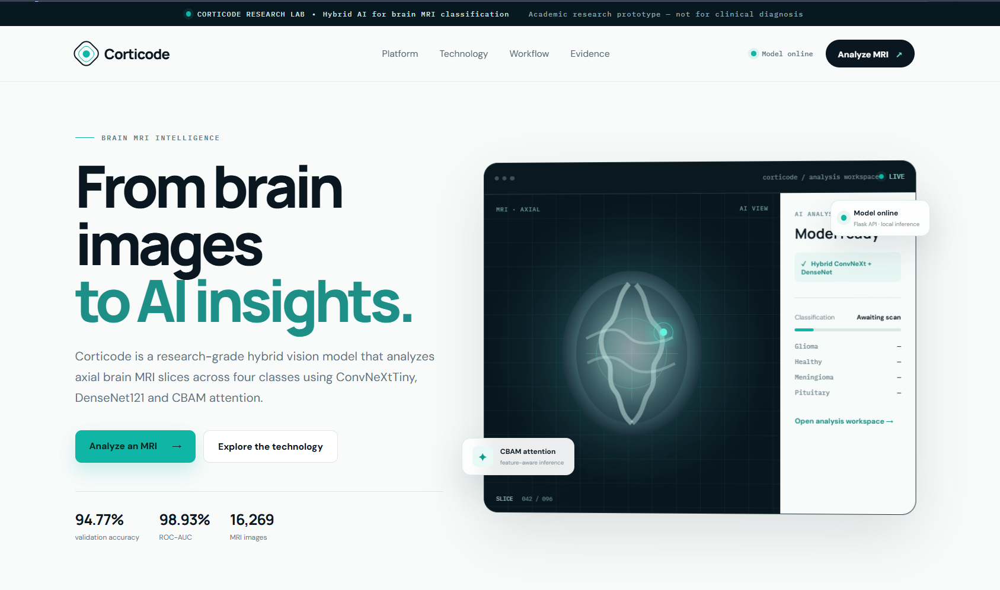
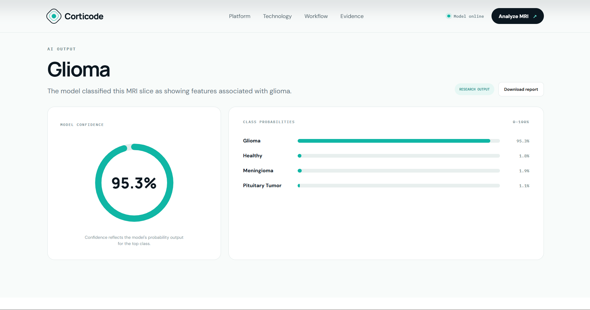
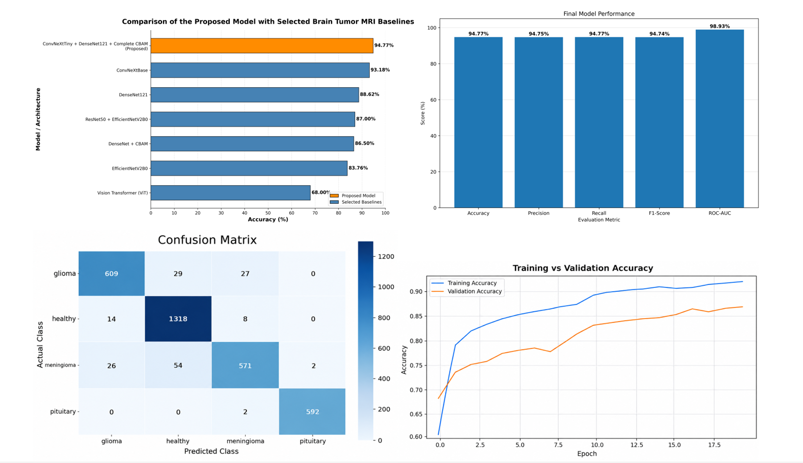

# Corticode — Brain Tumor MRI Classification System

### Deep Hybrid ConvNeXt-Tiny + DenseNet121 with CBAM Attention

An AI-powered Brain Tumor MRI Classification Web Application that uses a hybrid deep learning architecture to classify MRI images into four categories: **Glioma, Meningioma, Pituitary Tumor, and Healthy**.

The application combines ConvNeXt-Tiny, DenseNet121, and Convolutional Block Attention Module (CBAM) to extract complementary image features and improve classification.

---

## © Copyright & Ownership

Copyright © 2026. All rights reserved.

Corticode is an independently developed project. The source code, application implementation, model integration, and associated project materials are my original work.

No permission is granted to reproduce, redistribute, or commercially use this project without prior written permission from the author, except where otherwise permitted by applicable law.

---

## 📸 Application Screenshots

<!-- Add your actual application screenshots to the screenshots/ folder -->

### 1. Application Homepage


### 2. MRI Image Upload


### 3. Prediction Results


### 4. Model Performance


---

## ✨ Key Features

- MRI image upload through a web interface.
- Hybrid ConvNeXt-Tiny and DenseNet121 deep learning architecture.
- CBAM channel and spatial attention mechanisms.
- Four-class brain tumor classification.
- Prediction confidence and class-wise scores.
- Flask REST API backend.
- Responsive frontend built with HTML, CSS, and JavaScript.
- Model health-check endpoint.

---

## 🧠 Model Architecture

The proposed model combines two parallel CNN feature extraction branches:

1. **ConvNeXt-Tiny:** Extracts hierarchical visual features.
2. **DenseNet121:** Encourages feature reuse through dense connections.
3. **CBAM Attention:** Applies channel and spatial attention independently to both branches.
4. **Feature Fusion:** Combines the refined feature representations.
5. **Classification Head:** Uses fully connected layers and Softmax to predict four classes.

### Architecture Workflow

MRI Image → Preprocessing → ConvNeXt-Tiny + DenseNet121 → CBAM Attention → Feature Fusion → Classification → Prediction

---

## 📊 Model Performance

The model achieved the following results on the validation dataset:

| Evaluation Metric | Score |
|---|---:|
| Accuracy | **94.77%** |
| Precision | **94.75%** |
| Recall | **94.77%** |
| F1-Score | **94.74%** |
| ROC-AUC | **98.93%** |

### Classification Categories

- Glioma
- Meningioma
- Pituitary Tumor
- Healthy / No Tumor

**Dataset:** 16,269 MRI images  
**Input Size:** 224 × 224 × 3  
**Training-Validation Split:** 80:20

---

## 🏗️ Project Structure

```text
brain-tumor-cad/
│
├── backend/
│   ├── app.py
│   ├── model_builder.py
│   ├── requirements.txt
│   └── model/
│       ├── model.weights.h5
│       └── class_mapping.json
│
├── frontend/
│   ├── index.html
│   ├── style.css
│   └── script.js
│
├── screenshots/
│   ├── homepage.png
│   ├── image-upload.png
│   ├── prediction-result.png
│   └── model-performance.png
│
├── .gitignore
└── README.md
```

Note: The trained model weights are distributed separately through GitHub Releases and are not committed to the Git repository.

---

## ⚙️ Technologies Used

| Category | Technologies |
|---|---|
| Programming Language | Python, JavaScript |
| Deep Learning | TensorFlow, Keras |
| Architectures | ConvNeXt-Tiny, DenseNet121 |
| Attention Mechanism | CBAM |
| Backend | Flask, Flask-CORS |
| Frontend | HTML, CSS, JavaScript |
| Image Processing | Pillow, NumPy |
| Development | Kaggle, VS Code, Git, GitHub |

---

## 🚀 Installation and Setup

### 1. Clone the Repository

```bash
git clone https://github.com/sarthak3106/Deep-Hybrid-ConvNeXt-DenseNet121-Brain-Tumor-Classification.git

cd Deep-Hybrid-ConvNeXt-DenseNet121-Brain-Tumor-Classification
```

### 2. Download the Trained Model

Open the repository's **Releases** section and download `model.weights.h5`.

Place the downloaded file inside:

```text
backend/model/model.weights.h5
```

Make sure `class_mapping.json` is also present in the same folder.

### 3. Set Up the Backend

Open a terminal:

```bash
cd backend
python -m venv venv
```

Activate the virtual environment on Windows:

```bash
venv\Scripts\activate
```

Install dependencies:

```bash
pip install -r requirements.txt
```

Start the Flask backend:

```bash
python app.py
```

Backend address:

```text
http://localhost:5000
```

### 4. Start the Frontend

Open a second terminal:

```bash
cd frontend
python -m http.server 5500
```

Open the application in your browser:

```text
http://localhost:5500
```

---

## 🔗 API Endpoints

| Method | Endpoint | Description |
|---|---|---|
| GET | `/api/health` | Checks backend and model status |
| POST | `/api/predict` | Accepts an MRI image and returns prediction results |

### Prediction Workflow

1. User uploads an MRI image through the frontend.
2. JavaScript sends the image to the Flask API.
3. Backend preprocesses the image to 224 × 224 RGB.
4. The hybrid deep learning model performs inference.
5. The API returns the predicted class and confidence scores.
6. Frontend displays the prediction results.

---

## 🔮 Future Improvements

- Deploy the application online for public access.
- Add Grad-CAM visual explanations.
- Improve model generalization using external MRI datasets.
- Enhance the user interface and reporting features.
- Explore additional attention mechanisms and feature-fusion techniques.

---

## ⚠️ Disclaimer

This project is developed for educational and research purposes. It is not a certified medical diagnostic device and should not be used as a substitute for professional medical advice, diagnosis, or treatment. Clinical use would require extensive external validation and appropriate regulatory approval.

---

## ⭐ Support

If you find this project interesting, consider giving the repository a star!

**Repository:**  
https://github.com/sarthak3106/Deep-Hybrid-ConvNeXt-DenseNet121-Brain-Tumor-Classification